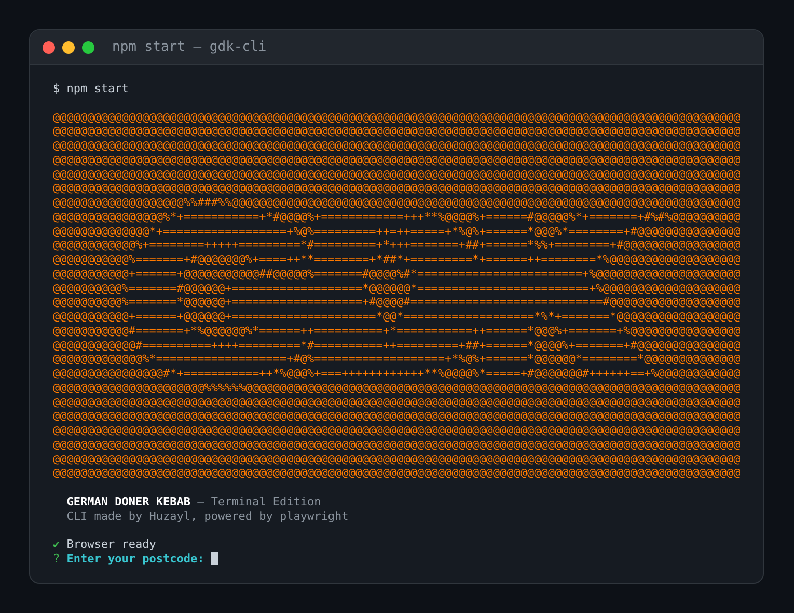

# GDK CLI

An unofficial terminal ordering interface for German Doner Kebab, powered by Playwright and Node.js.




---

## Requirements

- Node.js v18 or higher
- npm

---

## Setup

```bash
npm install
npm run install-browsers
```

---

## Usage

```bash
# Run headless (default)
npm start

# Run with a visible browser window
npm run start:headed
```

---

## What It Does

- Search for stores by postcode
- Browse the full menu by category
- Customise items (meat, sauce, fries, drinks, toppings)
- Add items to basket with confirmation
- View and manage your basket
- Opens a real browser window for checkout with optional form pre-fill

---

## Project Structure

```
src/
  cli.js        Entry point, all terminal prompts and user flow
  browser.js    Playwright controller, all GDK site interactions
  render.js     Terminal display helpers using Chalk
package.json
README.md
.gitignore
```

---

## How It Works

The CLI layer handles all user input and display. The browser layer controls a real Chromium instance behind the scenes. When you select options in the terminal, Playwright fills the corresponding form fields in the browser and submits them using the same API endpoints the website uses natively.

Checkout switches to a visible browser window so you can review your order and handle payment directly.

---

## Notes

- This is an unofficial tool and is not affiliated with German Doner Kebab or Hungrrr
- No payment details are handled or stored by this CLI
- Session cookies are kept in memory only and never written to disk
- Site structure may change without notice and could break functionality
